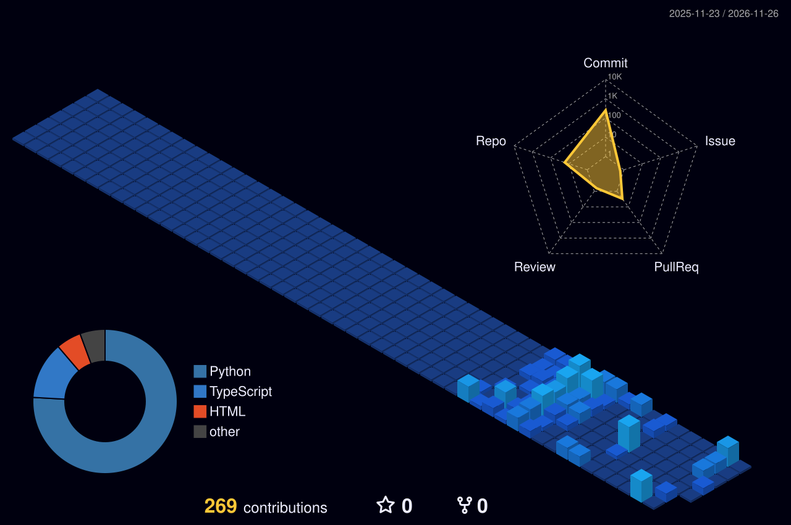

  

 

### Flagship Systems & Builds

<table>
  <tr>
    <td width="50%" valign="top">
      <h4>🍛 S.A.F — South Asian Fitness</h4>
      

        AI macro-tracking SaaS engineered to reverse-engineer traditional Desi cooking mechanics—calculating <em>bhunao</em> oil retention, dough lamination, and real-time food density where generic Western databases fail.
      

      

        <code>FastAPI</code> · <code>Next.js</code> · <code>DeepSeek Vision</code> · <code>@vercel/og</code> · <code>Sentry</code>
      

    </td>
    <td width="50%" valign="top">
      <h4>🧠 <a href="https://github.com/Moosa-natiezen/silo-breaker">Silo Breaker</a></h4>
      

        Always-on, hyper-private Personal AI knowledge graph that passively observes research rhythms and autonomously connects cross-domain insights over months of exploration.
      

      

        <code>NVIDIA Nemotron</code> · <code>Nebius AI</code> · <code>Neon pgvector</code> · <code>Next.js 16</code> · <code>Better Auth</code>
      

    </td>
  </tr>
  <tr>
    <td width="50%" valign="top">
      <h4>💳 <a href="https://github.com/Moosa-natiezen/Shenzhen-FinTech-SF-Assistant">Shenzhen FinTech Assistant</a></h4>
      

        Zero-trust cross-border student finance &amp; tuition platform featuring atomic <code>BigInt</code> double-entry ledger locks, a scaled-BigInt <em>Rscore</em> credit engine, <code>pgcrypto</code> AES-256-GCM encryption, and a Metro-2 export enclave.
      

      

        <code>Next.js 16</code> · <code>Neon Postgres</code> · <code>Drizzle ORM</code> · <code>RLS + MFA</code>
      

    </td>
    <td width="50%" valign="top">
      <h4>🔍 Enterprise Hybrid Search RAG</h4>
      

        Production retrieval pipeline combining dense vector embeddings, BM25 sparse search, Reciprocal Rank Fusion (RRF), cross-encoder re-ranking, and parent-child chunking with strict citation guardrails.
      

      

        <code>Python</code> · <code>FastAPI</code> · <code>Qdrant</code> · <code>Docker</code> · <code>Cross-Encoder</code>
      

    </td>
  </tr>
  <tr>
    <td width="50%" valign="top">
      <h4>🎙️ Alexa+ Voice DevOps Command Center</h4>
      

        Voice-first SRE orchestrator bridging natural language commands to live cloud infrastructure via custom Model Context Protocol (MCP) servers, Agent Skills, and streamable HTTP/SSE transports.
      

      

        <code>MCP SDK</code> · <code>Hono</code> · <code>Next.js</code> · <code>Vercel AI SDK</code> · <code>Neon DB</code>
      

    </td>
    <td width="50%" valign="top">
      <h4>☁️ Cloud-Native Three-Tier AWS IaC</h4>
      

        Multi-environment Terraform infrastructure provisioning isolated dev/prod VPCs, private-subnet AWS Lambda functions, API Gateway, S3/CloudFront CDN delivery, and strict least-privilege IAM boundaries.
      

      

        <code>Terraform</code> · <code>AWS VPC / Lambda</code> · <code>API Gateway</code> · <code>Better Auth</code>
      

    </td>
  </tr>
</table>

 

### Engineering Stack

| Domain | Technologies |
| :--- | :--- |
| **AI, Vision & Retrieval** | DeepSeek Vision, NVIDIA Nemotron, Nebius Token Factory, Qdrant, `pgvector`, Hybrid RAG (Dense + BM25 + RRF), MCP |
| **Backend & Security** | Python, FastAPI, Node.js, Hono, Drizzle ORM, Better Auth, PostgreSQL RLS, `pgcrypto` (AES-256-GCM) |
| **Frontend & Edge Media** | TypeScript, Next.js (App Router), React, Tailwind CSS, Dark-Mode HUD UIs, Satori / `@vercel/og` |
| **Cloud & DevOps** | AWS (VPC, Lambda, API Gateway, S3, CloudFront, IAM), Terraform, Docker, Sentry, Linux |

 

### Commit Skyline

  

 

### Telemetry & Elsewhere

- **Base:** Computer Science Undergraduate in İzmir, Türkiye (`UTC+3`)
- **Off-Screen:** Calisthenics (Front Levers & Muscle-Ups) · Competitive Futsal[cite: 3]
- **Build in Public:** [@fitnesssouthasian](https://instagram.com/fitnesssouthasian)[cite: 3] · [GitHub (`Moosa-natiezen`)](https://github.com/Moosa-natiezen)
